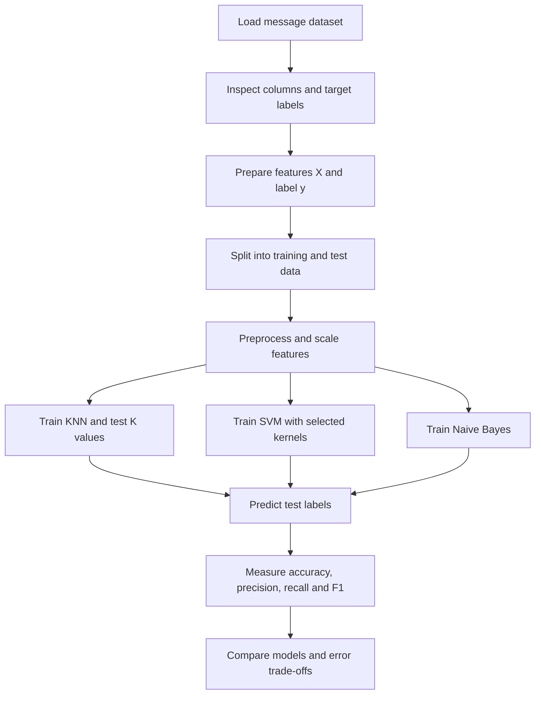

<div align="center">


# Message Intelligence System

**A machine-learning project for classifying messages as Spam or Legitimate.**

[](https://github.com/jeelprajapati0606/Message_intelligence_system/blob/main/message_intelligence/Message_Intelligence_system-checkpoint.ipynb)
[](https://github.com/jeelprajapati0606/Message_intelligence_system/tree/main/message_intelligence)
[](#-project-video)

  


</div>

---

## Overview

The **Message Intelligence System** explores how machine-learning models can distinguish spam messages from legitimate ones using numerical message and sender signals. The project compares three complementary approaches:

- **K-Nearest Neighbors (KNN)** — predicts from similar examples.
- **Support Vector Machine (SVM)** — separates classes using a decision boundary.
- **Naive Bayes** — estimates class probabilities using Bayes’ theorem.

In plain terms, the system learns from examples that are already labelled. For a new record, it uses its feature values to estimate whether the message belongs to class **0 (Legitimate)** or **1 (Spam)**.

> **Repository note:** The repository currently provides a dataset and Jupyter notebook. This README explains the project and intended workflow; refer to the notebook for the exact code and implementation details. No model scores are stated here because they have not been verified.

## Dataset

The repository contains a CSV file whose filename includes `5200`. The project description identifies features such as:

| Feature type | Examples |
|---|---|
| Message characteristics | Message length, URLs, special characters |
| Text-derived signals | Spam-keyword frequency or score |
| Sender behavior | Sender activity score |
| Timing | Time-based features |
| Prediction target | `Spam_Label` — 0 = Legitimate, 1 = Spam |

Check the dataset’s actual column names before running the notebook. Keep the target column out of the model inputs to avoid data leakage.

## Workflow



## How the models work

### K-Nearest Neighbors
KNN looks at the `K` closest training examples and predicts the class that appears most often among them. Since it relies on distances, feature scaling matters. A small `K` can be sensitive to individual examples; a larger `K` can produce smoother decisions.

### Support Vector Machine
SVM searches for a boundary that separates the classes while maximizing the margin between them. A linear kernel models a straight boundary, while kernels such as RBF can represent more complex relationships. Feature scaling is usually important for SVM.

### Naive Bayes
Naive Bayes applies Bayes’ theorem to estimate the probability that a message belongs to each class. It assumes features are conditionally independent once the class is known. That simplifying assumption makes the model fast, but correlated inputs may affect how well it fits the data.

## Important code concepts

The snippets below show standard patterns for this project. Variable names may differ from those used in the notebook.

### 1. Separate inputs and label

```python
X = df.drop(columns=["Spam_Label"])
y = df["Spam_Label"]
```

`X` contains the signals used to make a prediction. `y` contains the known answer used for training and evaluation.

### 2. Split data for evaluation

```python
from sklearn.model_selection import train_test_split

X_train, X_test, y_train, y_test = train_test_split(
    X, y,
    test_size=0.20,
    random_state=42,
    stratify=y
)
```

The training data teaches the model; the held-out test data checks its performance on examples it did not train on. Stratification helps preserve the class proportions in both sets.

### 3. Scale features correctly

```python
from sklearn.preprocessing import StandardScaler

scaler = StandardScaler()
X_train_scaled = scaler.fit_transform(X_train)
X_test_scaled = scaler.transform(X_test)
```

Fit the scaler on training data only, then apply that same transformation to the test data. This avoids leaking test-set statistics into training. Scaling is particularly important for KNN and SVM.

### 4. Evaluate predictions

```python
from sklearn.metrics import (
    accuracy_score, precision_score, recall_score, f1_score
)

model.fit(X_train_scaled, y_train)
y_pred = model.predict(X_test_scaled)

print("Accuracy:", accuracy_score(y_test, y_pred))
print("Precision:", precision_score(y_test, y_pred, zero_division=0))
print("Recall:", recall_score(y_test, y_pred, zero_division=0))
print("F1:", f1_score(y_test, y_pred, zero_division=0))
```

- **Accuracy:** fraction of all predictions that are correct.
- **Precision:** among messages flagged as spam, how many are truly spam?
- **Recall:** among all spam messages, how many did the model catch?
- **F1-score:** a balance between precision and recall.

For spam filtering, a false positive (blocking a legitimate message) and a false negative (letting spam through) have different consequences. Review the confusion matrix and choose metrics with that trade-off in mind.

## Run the notebook

1. Clone or download this repository.
2. Install Python 3 and Jupyter Notebook, or open the notebook in Google Colab.
3. Install commonly used dependencies:

   ```bash
   pip install pandas numpy matplotlib seaborn scikit-learn jupyter
   ```

4. From the repository root, launch Jupyter:

   ```bash
   jupyter notebook
   ```

5. Open `message_intelligence/Message_Intelligence_system-checkpoint.ipynb` and run its cells in order. If needed, update the CSV path in the notebook to match the file in `message_intelligence/`.

## Project video

[](https://youtu.be/REPLACE_WITH_YOUR_VIDEO_ID)

Replace `REPLACE_WITH_YOUR_VIDEO_ID` with the real YouTube video ID before publishing. Until then, this button is a placeholder.

## Limitations and responsible use

- Performance depends on the quality and representativeness of the dataset and labels.
- Correlated inputs may violate the Naive Bayes independence assumption.
- Accuracy alone can hide poor performance on one class; review precision, recall, F1, and the confusion matrix.
- Treat this as an educational project, not a ready-to-deploy security product. A real system needs representative validation, monitoring, privacy safeguards, and human review for consequential decisions.

## Repository structure

```text
Message_intelligence_system/
├── README.md
└── message_intelligence/
    ├── Message_Intelligence_Dataset_5200 - Message_Intelligence_Dataset_5200.csv.csv
    └── Message_Intelligence_system-checkpoint.ipynb
```

## Author

**Jeel Prajapati** · [GitHub profile](https://github.com/jeelprajapati0606)

---

<div align="center">


**Thank you for visiting.** If this project was useful, please consider starring the repository.

[](#message-intelligence-system)

</div>
